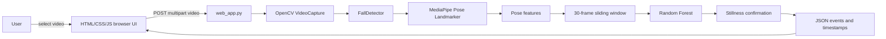
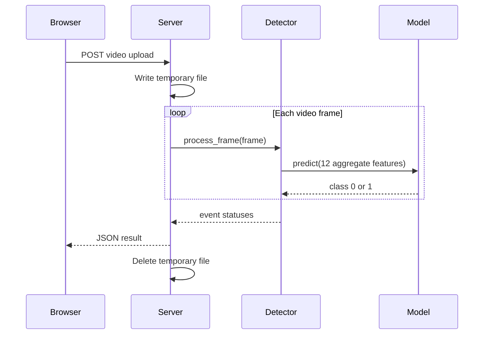

# Fallwatch Architecture

## Overview

Fallwatch is a local, synchronous video-analysis application. The browser handles file selection and presentation. The Python server owns the model, pose extraction, feature engineering, and event decision. Uploaded videos are stored temporarily during one request and deleted afterward.

## Components

### Browser layer

- `web/index.html` defines the upload form, video preview, status panel, statistics, and event log.
- `web/style.css` provides the responsive layout and visual states.
- `web/app.js` validates the selected file, sends `multipart/form-data` to `/api/analyze`, and renders the JSON response.

The browser does not load the model or perform inference. This keeps model files and native ML dependencies on the local machine.

### HTTP layer

`web_app.py` uses Python's `ThreadingHTTPServer` and `BaseHTTPRequestHandler`, so no third-party web framework is required.

Routes:

| Method | Route | Purpose |
| --- | --- | --- |
| GET | `/` | Serve the upload interface |
| GET | `/index.html`, `/style.css`, `/app.js` | Serve frontend assets |
| POST | `/api/analyze` | Analyze one uploaded video and return JSON |

The upload handler enforces a 250 MB request limit, accepts common video extensions, writes to a temporary file, analyzes the file, and removes it in a `finally` block.

### Inference layer

`src/Realtime_infer.py` contains `FallDetector`:

1. Decode one frame with OpenCV.
2. Convert BGR to RGB.
3. Detect one body pose with MediaPipe Tasks.
4. Convert landmarks to a `(33, 3)` NumPy array containing `x`, `y`, and visibility.
5. Keep the latest 30 frames in a deque.
6. Calculate aggregate features after the buffer is full.
7. Predict class `1` with the Random Forest.
8. If flagged, collect 2.5 seconds of pose history and measure centroid movement.
9. Return `confirmed_fall` when movement is below the configured threshold, otherwise `false_alarm`.

### Feature layer

`src/Features.py` derives four per-frame signals:

- Bounding-box aspect ratio
- Vertical body centroid
- Torso angle from vertical
- Vertical centroid velocity

Each 30-frame window is reduced to maximum, minimum, and mean values for each signal, producing 12 Random Forest inputs.

### Training layer

`src/Pose_extraction.py` creates one `.npy` keypoint file per source video. `src/Windowing.py` matches annotations by video stem, labels overlapping windows, and splits by video. `src/Train_rf.py` fits a class-balanced Random Forest and saves a bundle containing the classifier and feature names.

The optional `src/Train_lstm.py` consumes the same windows as raw `(30, 4)` sequences.

## Data flow

## Configuration

`config.yaml` controls pose confidence thresholds, window length and stride, target processing FPS, stillness confirmation duration and movement threshold, classifier hyperparameters, and default data/model paths.

The uploaded-video API uses the video's native FPS for timestamps. The detector's confirmation duration still follows `capture.target_fps`, so keep that setting close to the intended processing rate.

## Security and deployment boundary

The server binds to `127.0.0.1` by default and has no authentication. It is intended for local development and private testing only. Do not bind it to `0.0.0.0` or expose it through a reverse proxy without adding authentication, request limits, TLS, and isolation for uploaded media.

## Known limitations and extension points

- The model detects falls from body pose; it does not identify faces or people.
- Inference is synchronous, so one large upload occupies one worker thread for its duration.
- There is no annotated output video. A future endpoint could draw pose landmarks and event markers onto frames and return a rendered MP4.
- There is no persistent event database or alert integration. The `events` JSON response is the current integration boundary for notifications, dashboards, or storage.
- The feature extractor emits warnings when pose landmarks are missing. A production version could suppress warnings and add an explicit pose-detection quality metric to the response.
